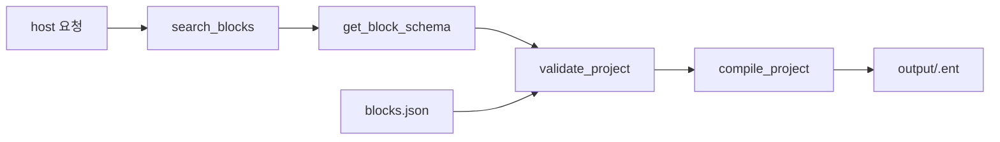

<p align="center">
  <strong>EntryVibe MCP</strong><br/>
  <em>텍스트 요청으로 Entry 프로젝트를 생성·컴파일하는 MCP 서버</em>
</p>

<p align="center">
  <a href="https://playentry.org"></a>
  <a href="https://modelcontextprotocol.io"></a>
  
  
  
</p>

[Entry](https://playentry.org) 프로젝트를 텍스트로 구성하고 `.ent`로 패키징하는 MCP 서버.

MCP 호스트에 연결해서 사용합니다. 서버는 상태를 저장하지 않으며 블록 검색·IR 검증·컴파일만 제공합니다.

## 설치

```bash
git clone https://github.com/seohuda/entry-vibe-mcp.git
cd entry-vibe-mcp
npm install
npm run build
```

`catalog/blocks.json`과 `.ent`에 들어가는 엔트리봇 미디어(`assets/media/`)는 repo에 포함돼 있어서 clone만 해도 컴파일까지 바로 됩니다.

카탈로그를 entryjs에서 다시 뽑을 때만:

```bash
npm run fetch:entryjs
npm run extract:catalog
```

## MCP 연결

Cursor — `~/.cursor/mcp.json`:

```json
{
  "mcpServers": {
    "entry-vibe": {
      "command": "node",
      "args": ["/absolute/path/to/entry-vibe-mcp/dist/server/index.js"]
    }
  }
}
```

개발 중엔 tsx:

```json
{
  "mcpServers": {
    "entry-vibe": {
      "command": "npx",
      "args": ["tsx", "/absolute/path/to/entry-vibe-mcp/server/index.ts"]
    }
  }
}
```

Claude Desktop은 `claude_desktop_config.json`에 똑같이 넣으면 됨.

## 쓰는 법

요청 텍스트로 작업을 지시하면 됩니다. 예:

> 엔트리봇이 4번 반복하면서 10칸씩 움직이고 벽에 튕기게 해줘

대략 이런 순서로 툴 호출함:

```
search_blocks → get_block_schema → validate_project → compile_project
```

결과물은 `output/`에 `.ent` + `project.json`으로 저장됨.

## 작동원리

서버는 호스트에서 넘긴 IR을 바탕으로 카탈로그 검증과 컴파일을 수행합니다.



## 툴

| 이름 | 하는 일 |
|------|---------|
| `list_categories` | 카테고리 목록 |
| `search_blocks` | 블록 검색 (query, category 옵션) |
| `get_block_schema` | 블록 상세 스키마 |
| `validate_project` | IR 검증 |
| `compile_project` | IR → `.ent` |

## IR 형식

호스트가 만들어서 넘기는 JSON. param은 이름으로, statement 슬롯도 `DO` 같은 이름으로 씀.

```json
{
  "objects": [{
    "name": "고양이",
    "sprite": "entrybot",
    "scripts": [[
      { "type": "when_run_button_click" },
      {
        "type": "repeat_basic",
        "params": { "VALUE": 4 },
        "statements": {
          "DO": [
            { "type": "move_direction", "params": { "VALUE": 10 } },
            { "type": "bounce_wall" }
          ]
        }
      }
    ]]
  }]
}
```

v1은 sprite `entrybot`만 지원. statement 키는 카탈로그 `statementKeys` 보고 맞추면 됨.

## `.ent` 구조

[entry-offline](https://github.com/entrylabs/entry-offline)이랑 같은 tar.gz:

```
temp/project.json
temp/media/entrybot1.svg
temp/media/entrybot2.svg
temp/media/bark.mp3
```

## 스크립트

| 명령 | 설명 |
|------|------|
| `npm run build` | tsc + catalog → dist 복사 |
| `npm start` | MCP 서버 (stdio) |
| `npm run dev:server` | tsx로 서버 |
| `npm test` | vitest |
| `npm run extract:catalog` | entryjs에서 카탈로그 재추출 |
| `npm run fetch:entryjs` | vendor/entryjs clone |

## 디렉터리

```
catalog/          블록 스키마 (entryjs AST 추출)
assets/media/     .ent에 패킹되는 엔트리봇 이미지/소리
compiler/         IR → project.json → .ent
server/           MCP stdio 서버
scripts/          추출기, fetch
test/             테스트 + fixture IR
```

블록 카탈로그는 entryjs `block_*.js` 파싱해서 만듦. AI/하드웨어 블록은 v1 제외, 블록 메뉴 버튼과 함수 파라미터 슬롯처럼 스크립트에 놓을 수 없는 항목도 제외 (12 카테고리, 194개).

## IR에서 변수 쓰기

`variables`에 선언하고, 블록의 `VARIABLE` 파라미터에서는 **이름으로** 참조합니다.
컴파일 단계에서 Entry 내부 변수 id로 치환됩니다. 선언 안 한 이름은 검증에서 걸립니다.

```json
{
  "variables": [{ "name": "점수", "initialValue": 0 }],
  "objects": [{
    "name": "엔트리봇",
    "sprite": "entrybot",
    "scripts": [[
      { "type": "when_run_button_click" },
      { "type": "set_variable", "params": { "VARIABLE": "점수", "VALUE": 0 } }
    ]]
  }]
}
```

리스트(`LIST` 파라미터)는 v1에서 지원하지 않습니다.

## 라이선스

MIT.

`assets/media/`의 엔트리봇 이미지와 소리는 [entrylabs/entryjs](https://github.com/entrylabs/entryjs)에서
가져온 파일로 Apache-2.0을 따릅니다. [assets/media/NOTICE.md](assets/media/NOTICE.md) 참고.
