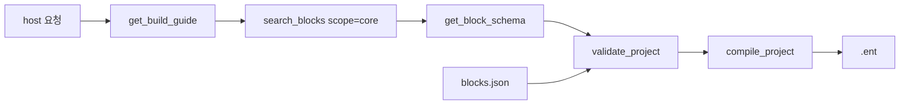

<p align="center">
  <strong>EntryVibe MCP</strong><br/>
  <em>텍스트 요청으로 Entry 프로젝트를 생성·컴파일하는 MCP 서버</em>
</p>

<p align="center">
  <a href="https://github.com/seohuda/entry-vibe-mcp/actions/workflows/ci.yml"></a>
  <a href="https://playentry.org"></a>
  <a href="https://modelcontextprotocol.io"></a>
  
  
  
</p>

[Entry](https://playentry.org) 프로젝트를 텍스트 요청으로 작성하고 `.ent` 파일로 컴파일하는 MCP 서버입니다.

MCP 호스트에 연결해서 사용합니다. 서버 자체는 상태를 저장하지 않으며, 블록 검색·IR 검증·컴파일 세 가지만 담당합니다.

예를 들어 "엔트리봇이 4번 반복하면서 10칸씩 움직이고 벽에 튕기게 해줘"라고 요청하면 `entry-project.ent`가 생성됩니다. 이 파일은 엔트리 오프라인이나 playentry.org에서 열 수 있습니다.

---

## 설치

Node.js 20 이상이 필요합니다.

설치/연결이 복잡하면, 사용하는 MCP 호스트(예: Cursor/Claude Code/OpenCode)에게 아래 한 문장만 그대로 요청하세요.

```text
이 레포를 로컬에 설치하고(dist/server/index.js 절대 경로 확인까지), 내 환경(OS/에디터)에 맞춰 entry-vibe MCP를 연결해줘.
```

```bash
git clone https://github.com/seohuda/entry-vibe-mcp.git
cd entry-vibe-mcp
npm install
npm run build
```

빌드가 끝나면 `dist/server/index.js`가 서버 진입점이 됩니다. MCP 호스트 설정에 절대 경로가 필요하므로 미리 확인해 둡니다.

```bash
# macOS / Linux
echo "$PWD/dist/server/index.js"

# Windows (PowerShell)
echo "$PWD\dist\server\index.js"
```

블록 카탈로그(`catalog/blocks.json`)와 `.ent`에 패킹되는 엔트리봇 미디어(`assets/media/`)는 repo에 포함되어 있습니다. clone 후 별도 다운로드 없이 바로 빌드하고 컴파일할 수 있습니다.

---

## MCP 연결

호스트마다 설정 방식이 다르므로 사용 중인 항목만 참고하면 됩니다. 아래 예시의 `/absolute/path/to/entry-vibe-mcp`는 위에서 확인한 절대 경로로 바꿔야 합니다. 상대 경로는 지원하지 않습니다.

### Claude Code

```bash
# 현재 프로젝트에만 적용 (기본값)
claude mcp add entry-vibe -- node /absolute/path/to/entry-vibe-mcp/dist/server/index.js

# 모든 프로젝트에 적용
claude mcp add entry-vibe --scope user -- node /absolute/path/to/entry-vibe-mcp/dist/server/index.js
```

팀과 공유하려면 `--scope project`를 사용합니다. 프로젝트 루트에 `.mcp.json`이 생성됩니다.

연결 확인은 `claude mcp list`를 실행해 `entry-vibe ✔ Connected`가 뜨는지 보면 됩니다.

### Claude Desktop

설정 → Developer → Edit Config에서 열리는 `claude_desktop_config.json`을 수정합니다.

- macOS: `~/Library/Application Support/Claude/claude_desktop_config.json`
- Windows: `%APPDATA%\Claude\claude_desktop_config.json`

```json
{
  "mcpServers": {
    "entry-vibe": {
      "command": "node",
      "args": ["/absolute/path/to/entry-vibe-mcp/dist/server/index.js"]
    }
  }
}
```

저장한 뒤 Claude Desktop을 완전히 종료했다가 다시 실행해야 적용됩니다. 창만 닫으면 반영되지 않습니다.

### Cursor

`~/.cursor/mcp.json`(전역) 또는 프로젝트 루트의 `.cursor/mcp.json`에 추가합니다.

```json
{
  "mcpServers": {
    "entry-vibe": {
      "command": "node",
      "args": ["/absolute/path/to/entry-vibe-mcp/dist/server/index.js"]
    }
  }
}
```

### VS Code (GitHub Copilot)

최상위 키가 `mcpServers`가 아니라 `servers`입니다. 프로젝트의 `.vscode/mcp.json`에 추가합니다.

```json
{
  "servers": {
    "entry-vibe": {
      "type": "stdio",
      "command": "node",
      "args": ["/absolute/path/to/entry-vibe-mcp/dist/server/index.js"]
    }
  }
}
```

전역으로 설정하려면 명령 팔레트에서 `MCP: Open User Configuration`을 실행한 뒤 같은 내용을 입력합니다.

### Codex CLI

```bash
codex mcp add entry-vibe -- node /absolute/path/to/entry-vibe-mcp/dist/server/index.js
```

또는 `~/.codex/config.toml`에 직접 작성합니다 (JSON이 아니라 TOML입니다).

```toml
[mcp_servers.entry-vibe]
command = "node"
args = ["/absolute/path/to/entry-vibe-mcp/dist/server/index.js"]
```

연결 확인은 `codex mcp list`로 합니다.

### OpenCode

프로젝트 루트의 `opencode.json`(또는 `opencode.jsonc`), 전역은 `~/.config/opencode/opencode.json`에 추가합니다. Claude Desktop과 달리 `command`가 문자열 배열이고 `type: "local"`이 필요합니다.

```json
{
  "$schema": "https://opencode.ai/config.json",
  "mcp": {
    "entry-vibe": {
      "type": "local",
      "command": ["node", "/absolute/path/to/entry-vibe-mcp/dist/server/index.js"],
      "enabled": true
    }
  }
}
```

연결 확인은 `opencode mcp list`로 합니다.

### Gemini CLI

```bash
gemini mcp add entry-vibe node /absolute/path/to/entry-vibe-mcp/dist/server/index.js
```

또는 `~/.gemini/settings.json`(프로젝트 한정은 `.gemini/settings.json`)에 직접 작성합니다.

```json
{
  "mcpServers": {
    "entry-vibe": {
      "command": "node",
      "args": ["/absolute/path/to/entry-vibe-mcp/dist/server/index.js"]
    }
  }
}
```

### Antigravity

`~/.gemini/config/mcp_config.json`(전역) 또는 워크스페이스의 `.agents/mcp_config.json`에 추가합니다.

```json
{
  "mcpServers": {
    "entry-vibe": {
      "command": "node",
      "args": ["/absolute/path/to/entry-vibe-mcp/dist/server/index.js"]
    }
  }
}
```

IDE에서는 에이전트 사이드 패널 상단의 `…` → MCP Servers → Manage MCP Servers → View raw config에서 직접 편집할 수 있습니다.

IDE와 CLI(`agy`)가 같은 설정 파일을 공유하므로 한 번만 등록하면 둘 다 적용됩니다. CLI에서는 `/mcp` 명령으로 확인합니다.

### 그 외 호스트

Windsurf, Cline 등 다수 호스트는 Claude Desktop과 동일하게 `mcpServers` + `command`/`args` 구조를 사용합니다. 설정 파일 위치만 각 호스트 문서에서 확인하면 됩니다.

다만 최상위 키가 다른 경우가 있습니다 — VS Code는 `servers`, Zed는 `context_servers`, Codex는 TOML, OpenCode는 `mcp` + `type`/`command` 배열 형식입니다. 적용 전 해당 호스트 문서에서 확인해야 합니다.

### 개발 중 실행

빌드 없이 TypeScript 소스를 바로 실행할 수도 있습니다. `command`/`args`만 아래처럼 바꾸면 됩니다.

```json
{
  "command": "npx",
  "args": ["tsx", "/absolute/path/to/entry-vibe-mcp/server/index.ts"]
}
```

### 연결 문제 해결

1. 경로가 절대 경로인지, `dist/server/index.js`가 실제로 존재하는지 확인합니다 (`npm run build`를 실행했는지 확인).
2. 터미널에서 직접 실행해 에러가 나는지 확인합니다 — `node /absolute/path/.../dist/server/index.js`. stdio 서버라 조용히 대기하는 것이 정상이며, 즉시 종료되면 문제가 있는 것입니다.
3. 호스트를 재시작합니다 (Claude Desktop은 완전히 종료해야 합니다).
4. Claude Desktop 로그는 macOS `~/Library/Logs/Claude/mcp*.log`, Windows `%APPDATA%\Claude\logs\`에서 확인합니다.

---

## 사용법

연결이 끝나면 텍스트 요청으로 지시하면 됩니다.

> 엔트리봇이 4번 반복하면서 10칸씩 움직이고 벽에 튕기게 해줘

호스트 LLM은 **반드시** 다음 순서로 툴을 호출합니다 (Unity/Adobe MCP처럼 AI가 툴만으로 작업을 끝내는 계약입니다).

```
get_build_guide → search_blocks(scope=core) → get_block_schema → validate_project → verify_project → compile_project
```

`validate_project` / `compile_project`가 `errors`와 `hints`를 반환하면 힌트대로 IR을 고친 뒤 다시 검증·컴파일합니다. 사람이 IR을 손댈 필요는 없습니다.

결과물은 MCP 호스트가 서버를 실행한 디렉터리에 `<이름>.ent`와 확인용 `<이름>.json`으로 바로 저장됩니다(별도의 `output/` 하위 폴더를 만들지 않습니다). 같은 이름의 파일이 이미 있으면 실수로 덮어쓰지 않도록 컴파일을 거부합니다 — 다른 이름을 쓰거나 `overwrite: true`를 넘기면 됩니다. `.ent`는 [엔트리 오프라인](https://playentry.org/download)에서 열거나 playentry.org에 업로드하면 됩니다.

다른 위치에 저장하고 싶다면 MCP 설정에서 서버 프로세스에 `ENTRY_VIBE_OUTPUT_DIR` 환경 변수를 지정하면 됩니다 (절대 경로 권장).

바로 컴파일해 볼 수 있는 예제는 [`examples/`](examples/)에 있습니다. MCP 호스트 없이도 `npm run example -- bounce-cat`처럼 로컬에서 바로 `.ent`를 뽑아볼 수 있습니다.

Cursor에서는 [`.cursor/rules/entry-vibe-mcp.mdc`](.cursor/rules/entry-vibe-mcp.mdc), [`SKILL.md`](SKILL.md), **[`AGENT-GUIDE.md`](AGENT-GUIDE.md)**(MCP 호스트 LLM용 전체 계약)가 위 워크플로를 강제합니다.

OpenCode 등 다른 호스트에서는 시스템 프롬프트나 `@AGENT-GUIDE.md`로 가이드를 넣어 주세요.

### 툴 목록

| 이름 | 기능 |
|------|------|
| `get_build_guide` | 요청 → 레시피·추천 블록·IR 스케치 (항상 먼저) |
| `list_categories` | 카테고리 목록 (`scope`: core\|ai\|hardware\|all, 기본 core) |
| `search_blocks` | 블록 검색 (`query`, `scope` 기본 core, `category`, `limit`) |
| `get_block_schema` | 블록 상세 스키마 (param 키, statement 키, 기본값) |
| `validate_project` | IR 검증 — `{ valid, errors, hints }` |
| `smoke_test_project` | validate + compile + 구조 검사 |
| `verify_project` | smoke + roundtrip + 시뮬레이션 (권장) |
| `simulate_project` | 코어 블록 실행 예측 (x/y/변수) |
| `compile_project` | IR → `.ent` — 실패 시 `{ ok:false, errors, hints }` |
| `audit_ent` | 기존 `.ent` 구조 감사 (name, media, func 참조) |
| `import_ent` | `.ent` → EntryIR 역컴파일 |
| `add_object` / `remove_object` / `patch_object` | 오브젝트 증분 편집 |
| `patch_script` | script thread replace/append/prepend |
| `add_scene` / `remove_scene` | 장면 추가/삭제 |
| `set_learning` | AI 학습 모델(`project.learning`) 설정 |

### 동작 방식

서버는 호스트가 전달한 IR을 카탈로그 기준으로 검증한 뒤 컴파일합니다. 블록을 고르고 IR을 구성하는 것은 호스트 쪽 LLM이 담당합니다. 기본 검색 범위는 **core**라서 하드웨어 수천 개가 결과를 오염시키지 않습니다.



---

## IR 형식

호스트가 생성해서 전달하는 JSON입니다. param은 이름으로, statement 슬롯도 `DO`와 같은 이름으로 지정합니다.

```json
{
  "objects": [{
    "name": "고양이",
    "sprite": "entrybot",
    "scripts": [[
      { "type": "when_run_button_click" },
      {
        "type": "repeat_basic",
        "params": { "VALUE": 4 },
        "statements": {
          "DO": [
            { "type": "move_direction", "params": { "VALUE": 10 } },
            { "type": "bounce_wall" }
          ]
        }
      }
    ]]
  }]
}
```

- 스크립트 스레드는 이벤트 블록(`when_run_button_click` 등)으로 시작해야 합니다.
- param 키와 statement 키는 `get_block_schema` 응답값을 그대로 사용합니다.
- sprite는 `entrybot`만 지원합니다. `pictures`를 생략하면 기본 엔트리봇 모양이 쓰입니다.
- 오브젝트에 `x` / `y`를 넣으면 무대 좌표가 반영됩니다.

### 커스텀 미디어 (`assets/`)

호스트 작업 디렉터리의 `assets/` 폴더에 파일을 넣은 뒤 IR에서 참조합니다. AI가 미디어를 저장할 위치도 여기입니다.

| 종류 | 확장자 | IR 필드 |
|------|--------|---------|
| 모양 | `.png`, `.svg` | `pictures` |
| 소리 | `.mp3` | `sounds` |

```json
{
  "objects": [{
    "name": "고양이",
    "sprite": "entrybot",
    "pictures": [
      { "name": "고양이", "path": "assets/cat.png" }
    ],
    "sounds": [
      { "name": "야옹", "path": "assets/meow.mp3", "duration": 1.2 }
    ],
    "scripts": [[
      { "type": "when_run_button_click" },
      { "type": "sound_something_with_block" },
      { "type": "move_direction", "params": { "VALUE": 10 } }
    ]]
  }]
}
```

- 경로는 `assets/` 아래만 허용합니다 (`..` 금지).
- `pictures` / `sounds`를 생략하면 기본 엔트리봇 모양·bark 소리를 씁니다.
- SVG만 넣을 때 같은 stem의 `.png`가 있으면 썸네일로 사용합니다.
- `compile_project` 실행 시 `assets/` 폴더가 없으면 만들어 둡니다.

### 변수

`variables`에 선언한 뒤, 블록의 `VARIABLE` 파라미터에서는 이름으로 참조합니다. 컴파일 단계에서 Entry 내부 변수 id로 치환됩니다. 선언하지 않은 이름을 쓰면 검증에서 오류가 발생합니다.

```json
{
  "variables": [{ "name": "점수", "initialValue": 0 }],
  "objects": [{
    "name": "엔트리봇",
    "sprite": "entrybot",
    "scripts": [[
      { "type": "when_run_button_click" },
      { "type": "set_variable", "params": { "VARIABLE": "점수", "VALUE": 0 } }
    ]]
  }]
}
```

### 리스트

`lists`에 선언한 뒤, 블록의 `LIST` 파라미터에서는 이름으로 참조합니다. 변수와 마찬가지로 컴파일 단계에서 Entry 내부 리스트 id로 치환됩니다.

```json
{
  "lists": [{ "name": "할일", "initialValues": ["숙제하기"] }],
  "objects": [{
    "name": "엔트리봇",
    "sprite": "entrybot",
    "scripts": [[
      { "type": "when_run_button_click" },
      { "type": "add_value_to_list", "params": { "VALUE": "방청소", "LIST": "할일" } }
    ]]
  }]
}
```

### 신호(메시지)

`messages`에 선언한 뒤, `message_cast` / `when_message_cast`의 **`VALUE`** 파라미터에 이름을 넣습니다 (키가 `MESSAGE`가 아님에 주의).

```json
{
  "messages": [{ "name": "시작" }],
  "objects": [{
    "name": "송신",
    "sprite": "entrybot",
    "scripts": [[
      { "type": "when_run_button_click" },
      { "type": "message_cast", "params": { "VALUE": "시작" } }
    ]]
  }]
}
```

### 함수

`functions`에 정의하고, 오브젝트 스크립트에서는 `function_call`로 호출합니다. `function_create`를 오브젝트 스크립트에 넣지 마세요.

```json
{
  "functions": [{
    "name": "한 걸음",
    "type": "statement",
    "body": [{ "type": "move_direction", "params": { "VALUE": 10 } }]
  }],
  "objects": [{
    "name": "엔트리봇",
    "sprite": "entrybot",
    "scripts": [[
      { "type": "when_run_button_click" },
      { "type": "function_call", "params": { "NAME": "한 걸음" } }
    ]]
  }]
}
```

### `.ent` 구조

[entry-offline](https://github.com/entrylabs/entry-offline) / playentry.org와 같은 tar.gz 구조입니다. 에셋은 `temp/media/`가 아니라 Entry 표준 해시 폴더(`ab/cd/image|thumb|sound`)에 들어갑니다.

```
temp/project.json
temp/ab/cd/image/{fileId}.svg
temp/ab/cd/image/{fileId}.png
temp/ab/cd/thumb/{fileId}.png
temp/ab/cd/sound/{fileId}.mp3
```

---

## 개발

기여 방법은 [CONTRIBUTING.md](CONTRIBUTING.md)를 참고하세요. 버그나 제안은 [Issues](https://github.com/seohuda/entry-vibe-mcp/issues)에 해당하는 템플릿으로 등록하면 됩니다. 참여자 간 지켜야 할 최소한의 규칙은 [CODE_OF_CONDUCT.md](CODE_OF_CONDUCT.md)에, 버전별 변경 사항은 [CHANGELOG.md](CHANGELOG.md)에 있습니다.

| 명령 | 설명 |
|------|------|
| `npm run build` | tsc 컴파일 후 catalog를 dist로 복사 |
| `npm start` | MCP 서버 실행 (stdio) |
| `npm run dev:server` | tsx로 서버 실행 |
| `npm test` | vitest 실행 |
| `npm run example -- <이름>` | `examples/`의 IR을 `.ent`로 컴파일 |
| `npm run fetch:entryjs` | `vendor/entryjs` clone (카탈로그 재추출용) |
| `npm run extract:catalog` | entryjs에서 카탈로그 재추출 |

```
catalog/          블록 스키마 (entryjs AST 추출)
assets/media/     .ent에 패킹되는 엔트리봇 이미지·소리
compiler/         IR → project.json → .ent
server/           MCP stdio 서버
scripts/          추출기, fetch, 예제 컴파일 스크립트
examples/         바로 컴파일해 볼 수 있는 IR 예제
test/             테스트 및 fixture IR
```

블록 카탈로그는 entryjs의 `block_*.js`(코어)와 AI·확장·`hardware/`·`hardwareLite/` 모듈을 파싱해서 생성합니다. 블록 메뉴 버튼이나 함수 파라미터 슬롯처럼 스크립트에 배치할 수 없는 항목은 제외합니다. 컴파일 시 AI 활용·확장·하드웨어 Lite 블록을 쓰면 프로젝트의 `aiUtilizeBlocks` / `expansionBlocks` / `hardwareLiteBlocks`가 자동으로 채워지고, 클래식 하드웨어는 `externalModules`에 모듈명이 들어갑니다. AI 학습 블록은 `ir.learning` + `set_learning`으로 `project.learning`을 생성합니다 (`assets/learning/*.json` sidecar 지원).

카탈로그를 다시 만들려면 entryjs 소스가 필요합니다.

```bash
npm run fetch:entryjs
npm run extract:catalog
```

---

## 라이선스

MIT입니다.

`assets/media/`의 엔트리봇 이미지와 소리는 [entrylabs/entryjs](https://github.com/entrylabs/entryjs)에서 가져온 파일로 Apache-2.0을 따릅니다. 자세한 내용은 [assets/media/NOTICE.md](assets/media/NOTICE.md)를 참고하세요.
