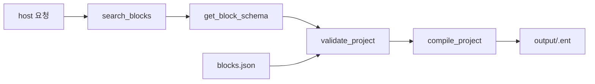

<p align="center">
  <strong>EntryVibe MCP</strong><br/>
  <em>텍스트 요청으로 Entry 프로젝트를 생성·컴파일하는 MCP 서버</em>
</p>

<p align="center">
  <a href="https://playentry.org"></a>
  <a href="https://modelcontextprotocol.io"></a>
  
  
  
</p>

[Entry](https://playentry.org) 프로젝트를 텍스트로 구성하고 `.ent`로 패키징하는 MCP 서버.

MCP 호스트에 연결해서 사용합니다. 서버는 상태를 저장하지 않으며 블록 검색·IR 검증·컴파일만 제공합니다.

> "엔트리봇이 4번 반복하면서 10칸씩 움직이고 벽에 튕기게 해줘"
> → `output/entry-project.ent` (엔트리 오프라인에서 열거나 playentry.org에 업로드)

---

## 설치

Node.js 20 이상이 필요합니다.

```bash
git clone https://github.com/seohuda/entry-vibe-mcp.git
cd entry-vibe-mcp
npm install
npm run build
```

빌드가 끝나면 서버 진입점은 `dist/server/index.js`입니다. 아래 설정에 쓸 절대 경로를 미리 확인해 두세요:

```bash
# macOS / Linux
echo "$PWD/dist/server/index.js"

# Windows (PowerShell)
echo "$PWD\dist\server\index.js"
```

블록 카탈로그(`catalog/blocks.json`)와 `.ent`에 패킹되는 엔트리봇 미디어(`assets/media/`)는 repo에 포함돼 있어서, clone만 해도 컴파일까지 바로 됩니다. entryjs를 따로 받을 필요 없습니다.

---

## MCP 연결

호스트마다 설정 방식이 다릅니다. 아래에서 쓰는 것만 골라 적용하세요.
`/absolute/path/to/entry-vibe-mcp`는 위에서 확인한 경로로 바꿔야 합니다. **상대 경로는 동작하지 않습니다.**

### Claude Code

CLI로 한 줄이면 됩니다.

```bash
# 이 프로젝트에서만 (기본값)
claude mcp add entry-vibe -- node /absolute/path/to/entry-vibe-mcp/dist/server/index.js

# 모든 프로젝트에서
claude mcp add entry-vibe --scope user -- node /absolute/path/to/entry-vibe-mcp/dist/server/index.js
```

팀과 공유하려면 `--scope project`를 쓰면 프로젝트 루트에 `.mcp.json`이 생성됩니다.

확인: `claude mcp list` → `entry-vibe  ✔ Connected`

### Claude Desktop

설정 → Developer → **Edit Config**로 여는 `claude_desktop_config.json`:

- macOS: `~/Library/Application Support/Claude/claude_desktop_config.json`
- Windows: `%APPDATA%\Claude\claude_desktop_config.json`

```json
{
  "mcpServers": {
    "entry-vibe": {
      "command": "node",
      "args": ["/absolute/path/to/entry-vibe-mcp/dist/server/index.js"]
    }
  }
}
```

저장 후 Claude Desktop을 **완전히 종료했다가** 다시 켜야 반영됩니다.

### Cursor

`~/.cursor/mcp.json` (전역) 또는 프로젝트 루트의 `.cursor/mcp.json`:

```json
{
  "mcpServers": {
    "entry-vibe": {
      "command": "node",
      "args": ["/absolute/path/to/entry-vibe-mcp/dist/server/index.js"]
    }
  }
}
```

### VS Code (GitHub Copilot)

키가 `mcpServers`가 아니라 **`servers`**입니다. 프로젝트의 `.vscode/mcp.json`:

```json
{
  "servers": {
    "entry-vibe": {
      "type": "stdio",
      "command": "node",
      "args": ["/absolute/path/to/entry-vibe-mcp/dist/server/index.js"]
    }
  }
}
```

전역으로 쓰려면 명령 팔레트에서 `MCP: Open User Configuration`을 실행해 같은 내용을 넣습니다.

### Codex CLI

```bash
codex mcp add entry-vibe -- node /absolute/path/to/entry-vibe-mcp/dist/server/index.js
```

또는 `~/.codex/config.toml`에 직접 (JSON이 아니라 **TOML**입니다):

```toml
[mcp_servers.entry-vibe]
command = "node"
args = ["/absolute/path/to/entry-vibe-mcp/dist/server/index.js"]
```

확인: `codex mcp list`

### Gemini CLI

```bash
gemini mcp add entry-vibe node /absolute/path/to/entry-vibe-mcp/dist/server/index.js
```

또는 `~/.gemini/settings.json` (프로젝트 한정은 `.gemini/settings.json`):

```json
{
  "mcpServers": {
    "entry-vibe": {
      "command": "node",
      "args": ["/absolute/path/to/entry-vibe-mcp/dist/server/index.js"]
    }
  }
}
```

### Antigravity

`~/.gemini/config/mcp_config.json` (전역) 또는 워크스페이스의 `.agents/mcp_config.json`:

```json
{
  "mcpServers": {
    "entry-vibe": {
      "command": "node",
      "args": ["/absolute/path/to/entry-vibe-mcp/dist/server/index.js"]
    }
  }
}
```

IDE에서 직접 열려면: 에이전트 사이드 패널 상단의 `…` → **MCP Servers** → **Manage MCP Servers** → **View raw config**.

IDE와 CLI(`agy`)가 같은 설정 파일을 공유하므로 한 번만 넣으면 둘 다 잡힙니다. CLI에서는 `/mcp`로 확인할 수 있습니다.

### 그 외 호스트

Windsurf, Cline 등 상당수 호스트가 Claude Desktop과 같은 `mcpServers` + `command` / `args` 형태를 씁니다. 설정 파일 위치만 해당 호스트 문서에서 확인하고 위 JSON을 그대로 넣으면 됩니다.

다만 키 이름이 다른 호스트가 있습니다 — VS Code는 `servers`, Zed는 `context_servers`, Codex는 TOML입니다. 넣기 전에 호스트 문서에서 최상위 키를 확인하세요.

### 개발 중이라면

빌드 없이 TypeScript 소스를 바로 실행할 수 있습니다. `command`/`args`만 바꾸면 됩니다.

```json
{
  "command": "npx",
  "args": ["tsx", "/absolute/path/to/entry-vibe-mcp/server/index.ts"]
}
```

### 연결이 안 될 때

1. 경로가 절대 경로인지, `dist/server/index.js`가 실제로 있는지 (`npm run build` 했는지) 확인
2. 터미널에서 직접 띄워봐서 에러가 나는지 확인 — `node /absolute/path/.../dist/server/index.js` (stdio 서버라 조용히 대기하는 게 정상, 즉시 종료되면 문제)
3. 호스트 재시작 (Claude Desktop은 완전 종료 필요)
4. Claude Desktop 로그: macOS `~/Library/Logs/Claude/mcp*.log`, Windows `%APPDATA%\Claude\logs\`

---

## 쓰는 법

연결했으면 그냥 말로 시키면 됩니다.

> 엔트리봇이 4번 반복하면서 10칸씩 움직이고 벽에 튕기게 해줘

호스트가 대략 이 순서로 툴을 호출합니다:

```
search_blocks → get_block_schema → validate_project → compile_project
```

결과물은 `output/`에 `.ent`와 `project.json`으로 저장됩니다. `.ent`는 [엔트리 오프라인](https://playentry.org/download)에서 열거나 playentry.org에 업로드하면 됩니다.

### 툴

| 이름 | 하는 일 |
|------|---------|
| `list_categories` | 카테고리 목록 |
| `search_blocks` | 블록 검색 (`query`, `category`, `limit`) |
| `get_block_schema` | 블록 상세 스키마 (param 키, statement 키, 기본값) |
| `validate_project` | IR 검증 (컴파일 없이) |
| `compile_project` | IR → `.ent` |

### 작동원리

서버는 호스트가 만들어 넘긴 IR을 카탈로그로 검증한 뒤 컴파일합니다. 블록을 고르고 IR을 조립하는 건 호스트 LLM의 몫입니다.



---

## IR 형식

호스트가 만들어서 넘기는 JSON. param은 이름으로, statement 슬롯도 `DO` 같은 이름으로 씁니다.

```json
{
  "objects": [{
    "name": "고양이",
    "sprite": "entrybot",
    "scripts": [[
      { "type": "when_run_button_click" },
      {
        "type": "repeat_basic",
        "params": { "VALUE": 4 },
        "statements": {
          "DO": [
            { "type": "move_direction", "params": { "VALUE": 10 } },
            { "type": "bounce_wall" }
          ]
        }
      }
    ]]
  }]
}
```

- 스크립트 스레드는 반드시 이벤트 블록(`when_run_button_click` 등)으로 시작해야 합니다.
- param 키와 statement 키는 `get_block_schema`가 알려주는 값을 그대로 씁니다.
- v1은 sprite `entrybot`만 지원합니다.

### 변수

`variables`에 선언하고, 블록의 `VARIABLE` 파라미터에서는 **이름으로** 참조합니다. 컴파일 단계에서 Entry 내부 변수 id로 치환됩니다. 선언하지 않은 이름은 검증에서 걸립니다.

```json
{
  "variables": [{ "name": "점수", "initialValue": 0 }],
  "objects": [{
    "name": "엔트리봇",
    "sprite": "entrybot",
    "scripts": [[
      { "type": "when_run_button_click" },
      { "type": "set_variable", "params": { "VARIABLE": "점수", "VALUE": 0 } }
    ]]
  }]
}
```

리스트(`LIST` 파라미터)는 v1에서 지원하지 않습니다.

### `.ent` 구조

[entry-offline](https://github.com/entrylabs/entry-offline)과 같은 tar.gz입니다:

```
temp/project.json
temp/media/entrybot1.svg
temp/media/entrybot2.svg
temp/media/bark.mp3
```

---

## 개발

| 명령 | 설명 |
|------|------|
| `npm run build` | tsc + catalog → dist 복사 |
| `npm start` | MCP 서버 (stdio) |
| `npm run dev:server` | tsx로 서버 |
| `npm test` | vitest |
| `npm run fetch:entryjs` | `vendor/entryjs` clone (카탈로그 재추출용) |
| `npm run extract:catalog` | entryjs에서 카탈로그 재추출 |

```
catalog/          블록 스키마 (entryjs AST 추출)
assets/media/     .ent에 패킹되는 엔트리봇 이미지/소리
compiler/         IR → project.json → .ent
server/           MCP stdio 서버
scripts/          추출기, fetch
test/             테스트 + fixture IR
```

블록 카탈로그는 entryjs `block_*.js`를 파싱해서 만듭니다. AI/하드웨어 블록은 v1에서 제외했고, 블록 메뉴 버튼이나 함수 파라미터 슬롯처럼 스크립트에 놓을 수 없는 항목도 뺐습니다 (12 카테고리, 194개).

카탈로그를 다시 뽑으려면 entryjs 소스가 필요합니다:

```bash
npm run fetch:entryjs
npm run extract:catalog
```

---

## 라이선스

MIT.

`assets/media/`의 엔트리봇 이미지와 소리는 [entrylabs/entryjs](https://github.com/entrylabs/entryjs)에서 가져온 파일로 Apache-2.0을 따릅니다. [assets/media/NOTICE.md](assets/media/NOTICE.md) 참고.
