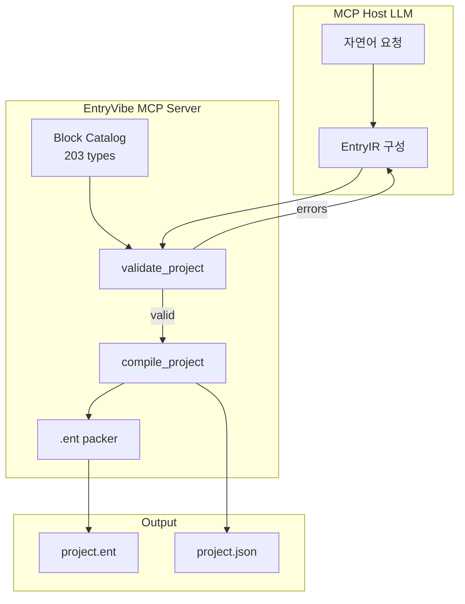

<p align="center">
  <strong>EntryVibe MCP</strong><br/>
  <em>자연어 한 줄로 Entry 작품을 만드는 MCP 서버</em>
</p>

<p align="center">
  <a href="https://playentry.org"></a>
  <a href="https://modelcontextprotocol.io"></a>
  
  
  
  
</p>

<p align="center">
  <a href="#quick-start">Quick Start</a> ·
  <a href="#how-it-works">How It Works</a> ·
  <a href="#tools">Tools</a> ·
  <a href="#configuration">Configuration</a> ·
  <a href="#architecture">Architecture</a>
</p>

---

> **"고양이가 화면 끝에서 튕기게 해줘"** — 이 한 문장이면 됩니다.  
> 프롬프트 엔지니어링은 필요 없습니다. LLM이 스스로 블록을 찾고, IR을 조립하고, `.ent` 파일까지 만들어 냅니다.

**EntryVibe MCP**는 [Entry(엔트리)](https://playentry.org) 블록 코딩 프로젝트를 **자연어로 생성·컴파일**하는 [Model Context Protocol](https://modelcontextprotocol.io) 서버입니다.

Claude Desktop, Claude Code, Cursor, ChatGPT(MCP 지원) 등 **어떤 MCP 호스트든** 연결하면, 호스트 LLM이 카탈로그를 탐색하고 중간 표현(IR)을 검증한 뒤 **실제 Entry `.ent` 파일**을 출력합니다. 서버는 상태를 들고 있지 않습니다 — 검색, 검증, 컴파일만 제공하는 **순수 함수형 툴**입니다.

---

## Why EntryVibe

| | 기존 방식 | EntryVibe MCP |
|---|---|---|
| **블록 스키마** | LLM 프롬프트에 138개 블록 전체 주입 | `search_blocks`로 필요한 것만 on-demand 조회 |
| **프로젝트 생성** | JSON 수동 작성 + 좌표 배치 | named-key IR → 자동 좌표 배치 + `.ent` 패킹 |
| **오류 처리** | 컴파일 실패 시 원인 불명 | `validate_project`로 self-correction 루프 |
| **호스트 의존** | 특정 LLM 전용 플러그인 | MCP 표준 — 벤더 중립 |

**203개 코어 블록** (시작·움직임·흐름·생김새·판단·계산·자료·함수·소리·글상자·붓·분석)을 entryjs 소스에서 AST로 추출한 **단일 진실 소스 카탈로그**를 기반으로 동작합니다.

---

## Quick Start

### 1. 설치

```bash
git clone https://github.com/your-org/entry-vibe-mcp.git
cd entry-vibe-mcp
npm install
npm run build
```

> 미디어 패킹·카탈로그 재생성이 필요하면 `npm run fetch:entryjs` 후 `npm run extract:catalog`를 실행하세요.  
> 기본 배포물에는 `catalog/blocks.json`이 포함되어 있어 바로 사용 가능합니다.

### 2. MCP 호스트 연결

**Cursor** — `~/.cursor/mcp.json` 또는 프로젝트 `.cursor/mcp.json`:

```json
{
  "mcpServers": {
    "entry-vibe": {
      "command": "node",
      "args": ["/absolute/path/to/entry-vibe-mcp/dist/server/index.js"]
    }
  }
}
```

**Claude Desktop** — `claude_desktop_config.json`에 동일한 `command` / `args`를 등록합니다.

**개발 모드** (빌드 없이):

```json
{
  "mcpServers": {
    "entry-vibe": {
      "command": "npx",
      "args": ["tsx", "/absolute/path/to/entry-vibe-mcp/server/index.ts"]
    }
  }
}
```

### 3. 사용

호스트 채팅창에 자연어로 요청합니다:

```
엔트리봇이 4번 반복하면서 10칸씩 움직이고 벽에 튕기게 해줘
```

LLM이 자동으로 아래 체인을 구성합니다:

```
list_categories → search_blocks → get_block_schema → validate_project → compile_project
```

산출물은 `output/` 디렉터리에 저장됩니다. Entry Offline에서 열거나 [playentry.org](https://playentry.org)에 업로드하세요.

---

## How It Works



1. **Catalog** — entryjs `block_*.js`를 Babel AST로 파싱해 `catalog/blocks.json` 생성
2. **IR** — LLM이 named param key + statement slot key(`DO`, `STACK_IF` …)로 중간 표현 작성
3. **Validate** — 카탈로그 대조: unknown type, 잘못된 param key, hat 블록 위치 등 즉시 거부
4. **Compile** — named params → Entry positional `params[]`, 스레드 `x`/`y` 자동 배치
5. **Pack** — entry-offline 호환 tar.gz `.ent` (`temp/project.json` + media)

---

## Tools

5개의 stateless MCP 툴. 각 `description`에 IR 스키마와 예시가 포함되어 있어, 별도 시스템 프롬프트 없이도 호스트 LLM이 self-correction 루프를 돌릴 수 있습니다.

| Tool | Input | Output | Role |
|------|-------|--------|------|
| `list_categories` | — | 카테고리 목록 + 블록 수 | 탐색 시작점 |
| `search_blocks` | `query`, `category?`, `limit?` | 블록 요약 (type, label, params) | 203개 전체를 한 번에 주지 않음 |
| `get_block_schema` | `types[]` | 상세 스키마 (param keys, statementKeys) | IR 작성 직전 정확한 필드 확인 |
| `validate_project` | `ir: EntryIR` | `{ valid, errors[] }` | 컴파일 전 자가 검증 |
| `compile_project` | `ir`, `filename?` | `.ent` 경로 + `project.json` | 최종 산출물 생성 |

---

## EntryIR Schema

LLM이 직접 생성하는 중간 표현. 포지셔널 params 대신 **named key** 기반 — 생성 안정성이 훨씬 높습니다.

```typescript
interface EntryIR {
  objects: Array<{
    name: string;
    sprite: 'entrybot';       // v1: entrybot 고정
    scripts: Thread[];
  }>;
  variables?: Array<{ name: string; initialValue: string | number }>;
}

type Thread = IRBlock[];       // 맨 위는 항상 hat 블록

interface IRBlock {
  type: string;
  params?: Record<string, string | number | boolean | IRBlock>;
  statements?: Record<string, Thread>;  // "DO", "STACK_IF", "STACK_ELSE" …
}
```

**예시 — 고양이가 4번 반복하며 이동·튕김:**

```json
{
  "objects": [{
    "name": "고양이",
    "sprite": "entrybot",
    "scripts": [[
      { "type": "when_run_button_click" },
      {
        "type": "repeat_basic",
        "params": { "VALUE": 4 },
        "statements": {
          "DO": [
            { "type": "move_direction", "params": { "VALUE": 10 } },
            { "type": "bounce_wall" }
          ]
        }
      }
    ]]
  }]
}
```

---

## `.ent` Format

[entry-offline](https://github.com/entrylabs/entry-offline)과 **바이트 호환** tar.gz 아카이브:

```
temp/
├── project.json
└── media/
    ├── entrybot1.svg
    ├── entrybot2.svg
    └── bark.mp3
```

Entry Offline · playentry.org · 엔트리 데스크톱 앱에서 그대로 열립니다.

---

## Configuration

| 환경 변수 | 기본값 | 설명 |
|-----------|--------|------|
| _(없음)_ | — | v0.1은 설정 없이 동작. 출력은 `{packageRoot}/output/` |

| Script | 설명 |
|--------|------|
| `npm run build` | TypeScript 컴파일 + catalog → `dist/` 복사 |
| `npm start` | stdio MCP 서버 실행 (`dist/server/index.js`) |
| `npm run dev:server` | 개발용 tsx hot path |
| `npm test` | Vitest (catalog · compiler · pack · API) |
| `npm run extract:catalog` | entryjs → `catalog/blocks.json` 재생성 |
| `npm run fetch:entryjs` | `vendor/entryjs` shallow clone |

---

## Architecture

```
entry-vibe-mcp/
├── catalog/
│   ├── blocks.json              # 203 blocks, single source of truth
│   └── blocks/{category}.json   # per-category split
├── compiler/
│   ├── skeleton.ts              # Entry.getStartProject() hardcoded
│   ├── validate.ts              # IR ↔ catalog validation
│   ├── compile.ts               # IR → project.json
│   └── pack.ts                  # tar.gz .ent packer
├── server/
│   ├── index.ts                 # MCP stdio entrypoint
│   ├── tools.ts                 # 5 tool registrations
│   └── catalog-api.ts           # search / schema lookup
├── scripts/
│   ├── extract-catalog.ts       # Babel AST extractor
│   └── fetch-entryjs.ts         # vendor bootstrap
└── test/
    ├── fixtures/                # golden IR fixtures
    └── *.test.ts                # 16 tests
```

**설계 원칙**

- **Stateless** — 서버는 프로젝트 상태를 세션으로 보관하지 않음 (MCP 2025 spec 방향)
- **Catalog-driven** — 블록 정의를 리버스엔지니어링하지 않고 entryjs 소스에서 AST 추출
- **Self-correction** — 검증/컴파일 에러를 호스트 LLM에 그대로 반환, 수정은 LLM의 역할
- **Host-agnostic** — Claude / Cursor / ChatGPT 등 MCP 호스트 공통

---

## Compatibility

| MCP Host | Transport | Status |
|----------|-----------|--------|
| Cursor | stdio | Supported |
| Claude Desktop | stdio | Supported |
| Claude Code | stdio | Supported |
| ChatGPT Desktop | stdio | Supported (MCP enabled) |
| Remote / HTTP+SSE | — | Planned (v2) |

| Entry Runtime | `.ent` Load | Status |
|---------------|-------------|--------|
| Entry Offline | tar.gz unpack | Verified |
| playentry.org | upload | Manual verification |

---

## Roadmap

- [x] Phase 1 — Block catalog AST extractor (12 categories, 203 blocks)
- [x] Phase 2 — IR compiler + entry-offline compatible `.ent` packer
- [x] Phase 3 — MCP stdio server + 5 tools
- [ ] v1.1 — Additional sprite library (beyond entrybot)
- [ ] v2 — HTTP+SSE transport for remote MCP clients
- [ ] v2 — AI / hardware block categories
- [ ] v2 — Playwright E2E against playentry.org

---

## Contributing

```bash
npm install
npm run fetch:entryjs
npm test
```

Conventional Commits: `feat(catalog|compiler|server): ...`

---

## License

MIT — see [LICENSE](LICENSE) for details.

---

<p align="center">
  Built for educators, students, and anyone who wants to <strong>vibe-code Entry</strong>.<br/>
  <sub>Powered by <a href="https://github.com/entrylabs/entryjs">entryjs</a> · <a href="https://modelcontextprotocol.io">MCP</a></sub>
</p>
